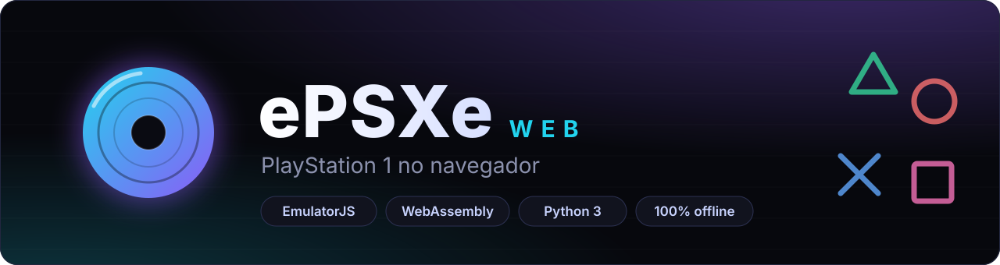
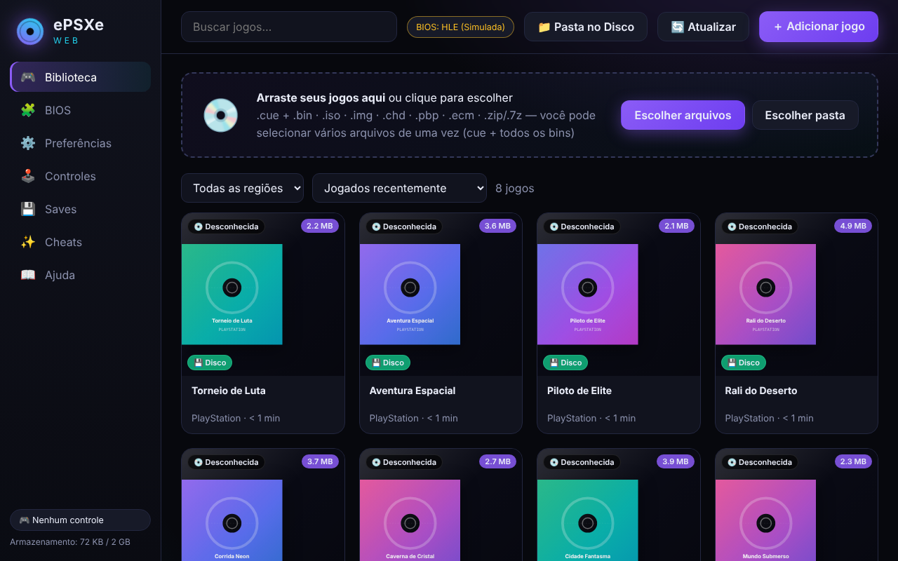
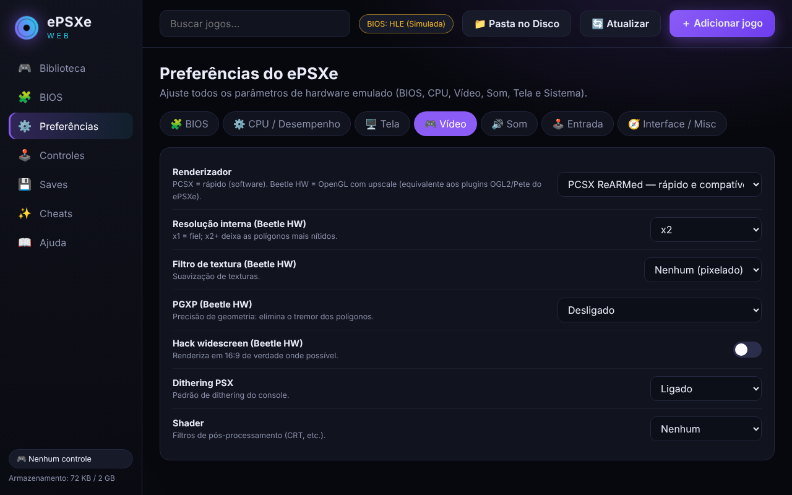
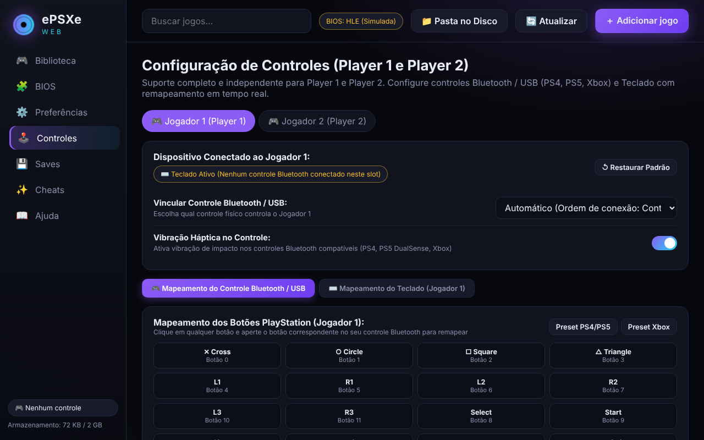
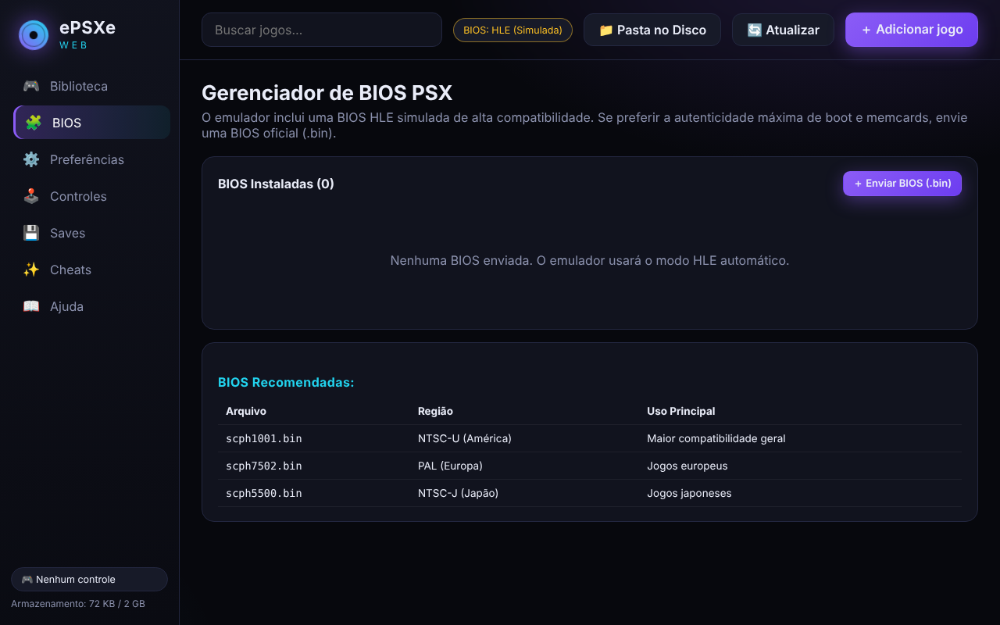
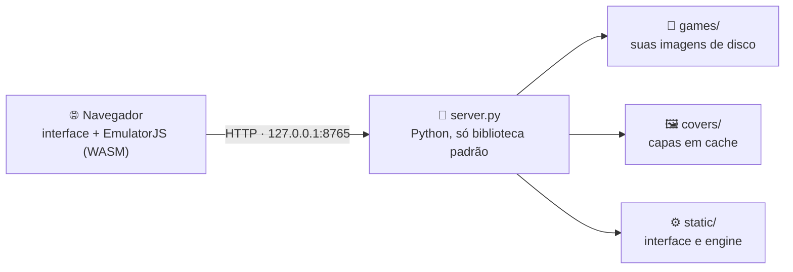

<a id="readme-top"></a>

<div align="center">

<br>Jogue PlayStation 1 direto no navegador.
Interface escura, biblioteca com capas, controles USB e Bluetooth, save states e cheats, tudo rodando na sua máquina.

<br>Python · Plataformas · Engine · Dependências
Recursos  · Instalação  · Como usar  · Solução de problemas

</div>
<br>
<table>
  <tr>
    <td align="center" width="50%">
      
      <br><sub><b>Biblioteca</b> · capas, busca e filtro por região</sub>
    </td>
    <td align="center" width="50%">
      
      <br><sub><b>Preferências</b> · renderizador, resolução, PGXP e shaders</sub>
    </td>
  </tr>
  <tr>
    <td align="center">
      
      <br><sub><b>Controles</b> · jogadores 1 e 2, gamepad e teclado</sub>
    </td>
    <td align="center">
      
      <br><sub><b>BIOS</b> · HLE por padrão, BIOS oficial opcional</sub>
    </td>
  </tr>
</table>
<p align="center"><sub>Capturas feitas com jogos fictícios, só para ilustrar a interface.</sub></p>

[!IMPORTANT]
Este repositório não inclui jogos nem BIOS. Use apenas imagens de disco e BIOS que você possui legalmente.

## 🧭 Sobre o projeto
O emulador em si é o EmulatorJS com dois cores libretro compilados para WebAssembly: PCSX ReARMed e Beetle PSX HW. Por cima dele há uma interface e um pequeno servidor local em Python (`server.py`) que guarda os seus jogos em disco, identifica o serial de cada um, busca as capas e entrega as imagens de disco por streaming. 



O servidor escuta apenas em 127.0.0.1. BIOS, preferências, mapeamento de controles, cartões de memória e save states ficam no armazenamento do navegador (IndexedDB e localStorage), não em arquivos locais do projeto.

## ✨ Recursos

| Recurso | Detalhes |
|---|---|
| 📚 **Biblioteca** | Busca automática de capas, filtros por região e ordenação. |
| 💿 **Formatos** | Suporta `.cue`+`.bin` (agrupa várias faixas), `.chd`, `.iso`, `.img`, `.pbp`, `.zip` e `.7z`. |
| 🔎 **Banco de Dados** | ~11 mil jogos reconhecidos automaticamente pelo serial (`SYSTEM.CNF`). |
| 🎛️ **Renderizadores** | PCSX ReARMed (rápido) ou Beetle PSX HW (OpenGL, upscaling, PGXP). |
| 📺 **Vídeo** | Formatos 4:3, 16:9, scanlines e shaders (CRT Easymode, Aperture, SABR, etc). |
| 🎮 **Controles** | Suporte a Gamepads (PS4, PS5, Xbox, genéricos) e teclado remapeável. |
| 💾 **Utilitários** | 5 slots de *save state*, cheats GameShark e troca de disco pelo menu. |

## 📋 Requisitos e Instalação

* **Python:** 3.8 ou superior (sem dependências externas).
* **Navegador:** Chrome ou Edge recentes.

🚀 Início rápido
Sistema	Como iniciar	Depois
🪟 Windows	Dois cliques em iniciar.bat	O navegador abre em http://127.0.0.1:8765/
🐧 Linux	python3 server.py na pasta do projeto	Abra http://127.0.0.1:8765/ se o navegador não abrir sozinho
🍎 macOS	python3 server.py na pasta do projeto	Abra http://127.0.0.1:8765/ se o navegador não abrir sozinho

Com a página aberta, arraste um jogo para a janela e clique nele para jogar.

Requisitos:
    Python: 3.8 ou superior. Não há dependências para instalar com pip.
    Navegador: Chrome ou Edge recentes (necessitam de WebAssembly, SharedArrayBuffer e WebGL2).

**🪟 Windows:**

Baixe o projeto para uma pasta local (evite `C:\Program Files`). Você pode dar um duplo clique em `iniciar.bat` ou executar os comandos no terminal:

```powershell
python --version
.\iniciar.bat
```

*O navegador abrirá automaticamente em `http://127.0.0.1:8765/`.*

**🐧 Linux / 🍎 macOS:**

1. **Verifique o Python:** Abra o terminal e confirme se o Python 3 está instalado:

```bash
python3 --version
```

2. **Prepare os arquivos:** Clone o repositório (ou extraia o arquivo `.zip`) e entre na pasta do projeto:

```bash
git clone https://github.com/analyst666/epsxe-web.git
cd epsxe-web
```

3. **Inicie o servidor:**

```bash
python3 server.py
```

*Por fim, acesse `http://127.0.0.1:8765/` no seu navegador. (Para usar uma porta diferente, execute `python3 server.py 9000`).*

2 · Configurar
Nada é obrigatório. Estas são as opções mais úteis:
Os arquivos iniciar.bat e iniciar.ps1 são só para Windows. No Linux, inicie o servidor diretamente.

<b>Mudar a porta</b> (padrão: 8765)</summary>
```bash
python3 server.py
```

Ao mudar a porta, o navegador trata como outro site e você precisa reconfigurar BIOS, preferências e controles.
Dica para mudar a porta: Execute python3 server.py 9000. Lembre-se que o navegador trata portas diferentes como sites distintos (você precisará reconfigurar a BIOS e os controles).


## 🔎 Onde encontrar jogos na internet

Caso não possua os arquivos físicos e precise buscar cópias digitais (ROMs) dos seus jogos, a forma mais prática de achar as versões compatíveis (nos formatos `.cue`/`.bin`, `.chd` ou `.iso`) é usando os termos de busca corretos no Google.

Experimente pesquisar por:
* `romsfun playstation`
* `romsfun psx`

**Dicas importantes:**
* Ao baixar, prefira as versões da região **"USA"** se desejar o jogo com textos e áudio em inglês.
* Muitos jogos vêm compactados. Certifique-se de extrair os arquivos de dentro dos pacotes `.zip` ou `.7z` antes de adicion


## 🎮 Como Jogar

**1. Adicionando Jogos**

Na aba **Biblioteca**, arraste os arquivos do jogo para a janela. 
* *Dica de busca:* Caso precise encontrar cópias digitais (ROMs) na internet, pesquise no Google por `romsfun playstation` ou `romsfun psx` (prefira versões "USA" e lembre-se de extrair arquivos `.zip` se contiverem faixas `.bin`).

**2. Configurando a BIOS (Recomendado)**

Para maior compatibilidade, vá na aba **BIOS**, envie um arquivo oficial (ex: `scph1001.bin`) e em **Preferências → BIOS**, mude de "HLE" para "Oficial".

**3. Controles e Atalhos**

Conecte o controle e aperte qualquer botão para ele ser detectado.

* **Menu de pausa:** <kbd>Esc</kbd> ou botão <kbd>Guide</kbd> do controle.
* **Save State:** <kbd>Select</kbd> + <kbd>R1</kbd> (Salvar) / <kbd>Select</kbd> + <kbd>L1</kbd> (Carregar).
* **Avanço rápido:** <kbd>Espaço</kbd> ou segurar <kbd>Select</kbd> + <kbd>R2</kbd>.

## 🗂️ Estrutura e API

```text
epsxe-web/
├── server.py              Servidor local (Python)
├── iniciar.bat            Atalho Windows
├── static/                Interface web, JS, banco de jogos e motor (WASM)
├── games/                 Suas imagens de disco (criada automaticamente)
└── covers/                Capas em cache (criada automaticamente)
```

**🔌 API do Servidor (127.0.0.1:8765)**

* `GET /api/status`: Estado do servidor e quantidade de jogos.
* `GET /api/games`: Lista os jogos em `games/`.
* `GET /api/games/file?name=X`: Entrega o arquivo (suporte a Range para streaming).
* `POST /api/games/upload`: Salva arquivos enviados via interface.
* `DELETE /api/games/delete`: Remove um arquivo.

## 🩺 Solução de Problemas

* **Tela preta:** Acesse sempre pelo IP local (`http://127.0.0.1:8765/`) e nunca abrindo o `.html` direto do disco.
* **Controle não responde:** Clique na tela do emulador uma vez para o navegador "focar" e liberar o controle.
* **Lentidão:** Use o renderizador *PCSX ReARMed*, ative *Multi-thread* e *Frame skip automático* nas preferências.
