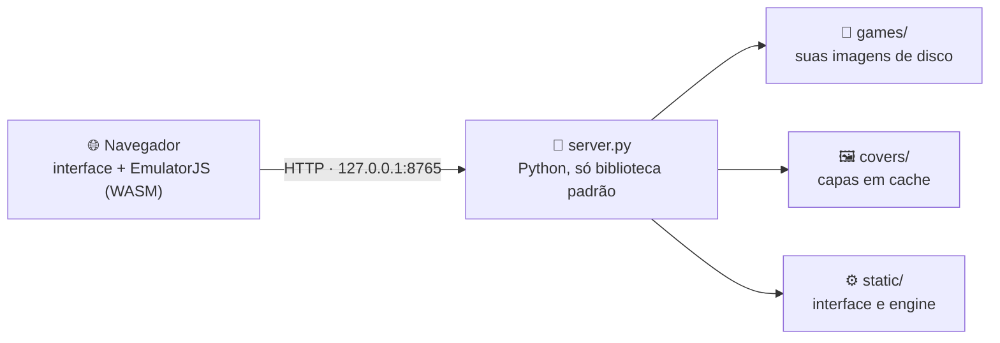

 Jogue PlayStation 1 direto no navegador.
Interface escura, biblioteca com capas, controles USB e Bluetooth, save states e cheats, tudo rodando na sua máquina.

 Python · Plataformas · Engine · Dependências
Recursos  · Instalação  · Como usar  · Solução de problemas

 
<table>
  <tr>
    <td align="center" width="50%">
      
       <b>Biblioteca</b> · capas, busca e filtro por região
    </td>
    <td align="center" width="50%">
      
       <b>Preferências</b> · renderizador, resolução, PGXP e shaders
    </td>
  </tr>
  <tr>
    <td align="center">
      
       <b>Controles</b> · jogadores 1 e 2, gamepad e teclado
    </td>
    <td align="center">
      
       <b>BIOS</b> · HLE por padrão, BIOS oficial opcional
    </td>
  </tr>
</table>

Capturas feitas com jogos fictícios, só para ilustrar a interface.

[!IMPORTANT]
Este repositório não inclui jogos nem BIOS. Use apenas imagens de disco e BIOS que você possui legalmente.

## 🧭 Sobre o projeto
O emulador em si é o EmulatorJS com dois cores libretro compilados para WebAssembly: PCSX ReARMed e Beetle PSX HW. Por cima dele há uma interface e um pequeno servidor local em Python (`server.py`) que guarda os seus jogos em disco, identifica o serial de cada um, busca as capas e entrega as imagens de disco por streaming. 

O servidor escuta apenas em 127.0.0.1. BIOS, preferências, mapeamento de controles, cartões de memória e save states ficam no armazenamento do navegador (IndexedDB e localStorage), não em arquivos locais do projeto.

✨ Recursos
	Recurso	O que faz
📚	Biblioteca	Capas, busca, filtro por região e ordenação (recentes, título, adicionados, tempo de jogo).
💿	Arrastar e soltar	.cue + .bin, .iso, .img, .chd, .pbp, .ecm, .zip e .7z. Vários arquivos de uma vez, ou uma pasta inteira.
🧩	.cue com várias faixas	O .cue e todos os .bin, incluindo faixas de áudio, são agrupados como um único jogo.
🔎	Banco com ~11 mil jogos	O serial é lido da imagem (SYSTEM.CNF) ou do nome do arquivo e preenche título, região, gênero e editora.
🖼️	Capas automáticas	Baixadas na primeira vez e guardadas em covers/, ou personalizadas por jogo.
🎛️	Dois renderizadores	PCSX ReARMed: rápido e compatível. Beetle PSX HW: OpenGL, resolução interna de x1 a x16, PGXP, filtros de textura e hack de widescreen.
📺	Vídeo	4:3, 16:9 ou esticar, scanlines, brilho e shaders (CRT Easymode, CRT Aperture, CRT Geom, SABR, bicúbico).
🎮	Controles	Gamepads USB e Bluetooth (PS4, PS5, Xbox e genéricos) para os jogadores 1 e 2, teclado remapeável, zona morta, inversão do eixo Y e vibração.
💾	Save states e cheats	5 slots de save state, cheats GameShark, troca de disco e reset pelo menu de pausa.
⚡	Multi-thread	WebAssembly threads, com os cabeçalhos COOP/COEP já enviados pelo servidor.
📴	Funciona offline	O EmulatorJS e os cores já estão em static/engine/. A internet só é usada para baixar capas.
👤	Perfil por jogo	Renderizador e tipo de controle podem ser definidos individualmente.
📋 Requisitos
Item	Detalhe
Python	3.8 ou superior (testado com 3.13). Não há dependências para instalar com pip.
Navegador	Chrome ou Edge recentes são os recomendados. Precisa de WebAssembly, SharedArrayBuffer e WebGL2. Firefox deve funcionar; Safari não foi testado.
Máquina	O PCSX ReARMed roda em computadores modestos. O Beetle PSX HW em resoluções altas exige uma GPU razoável.
Disco	Cerca de 20 MB para o projeto (engine e capas incluídos), mais o tamanho dos seus jogos.
Internet	Opcional, só para baixar capas.

🚀 Início rápido
Sistema	Como iniciar	Depois
🪟 Windows	Dois cliques em iniciar.bat	O navegador abre em http://127.0.0.1:8765/
🐧 Linux	python3 server.py na pasta do projeto	Abra http://127.0.0.1:8765/ se o navegador não abrir sozinho
🍎 macOS	python3 server.py na pasta do projeto	Abra http://127.0.0.1:8765/ se o navegador não abrir sozinho

Com a página aberta, arraste um jogo para a janela e clique nele para jogar.

Requisitos:
    Python: 3.8 ou superior. Não há dependências para instalar com pip.
    Navegador: Chrome ou Edge recentes (necessitam de WebAssembly, SharedArrayBuffer e WebGL2).

🪟 Windows
    Confirme que tem o Python instalado (python --version).
    Baixe o projeto para uma pasta local (evite C:\Program Files).
    Dê um duplo clique no arquivo iniciar.bat (ou execute .\iniciar.ps1 no PowerShell).
    O navegador abrirá no endereço http://127.0.0.1:8765/.
    
🐧 Linux

[!NOTE] Resumo: instale Python 3 e Git, clone o projeto e rode python3 server.py.

1 · Instalar
Instale Python 3 e Git (na maioria das distribuições o Python já vem instalado):
bash
   # Debian, Ubuntu, Linux Mint
   sudo apt update && sudo apt install -y python3 git

   # Fedora
   sudo dnf install -y python3 git

   # Arch, Manjaro
   sudo pacman -S --needed python git

Confirme:
bash
   python3 --version
Baixe o projeto:
bash
   git clone https://github.com/analyst666/epsxe-web.git
   cd epsxe-web

Ou baixe o ZIP pelo GitHub e extraia com unzip epsxe-web-main.zip.

2 · Configurar
Nada é obrigatório. Estas são as opções mais úteis:
[!NOTE] Os arquivos iniciar.bat e iniciar.ps1 são só para Windows. No Linux, inicie o servidor diretamente.

 
<b>Mudar a porta</b> (padrão: 8765)

bash
python3 server.py 9000

[!WARNING] Ao mudar a porta, o navegador trata como outro site e você precisa reconfigurar BIOS, preferências e controles.
Dica para mudar a porta: Execute python3 server.py 9000. Lembre-se que o navegador trata portas diferentes como sites distintos (você precisará reconfigurar a BIOS e os controles).

🎮 Usar o Emulador
1. Adicionar jogos e procurar na internet
Na aba Biblioteca, arraste os arquivos para a janela, ou use os botões da interface.
    .cue + .bin: Selecione todos os arquivos correspondentes de uma vez.
    .chd ou .iso: Basta um único arquivo.

🔎 Onde encontrar jogos:
Caso não possua os arquivos físicos e precise procurar cópias digitais (ROMs), a forma mais prática de achar versões compatíveis é pesquisar no Google por:
    romsfun playstation
    romsfun psx(Prefira as versões "USA" para ter o jogo em inglês e lembre-se de extrair arquivos .zip ou .7z se contiverem várias faixas .bin).

2. BIOS (Opcional, mas recomendado)
Por padrão, o emulador usa uma BIOS simulada (HLE). Para máxima compatibilidade:
    Vá na aba BIOS e envie um arquivo .bin oficial (ex: scph1001.bin para NTSC-U).
    Em Preferências → BIOS, altere de "HLE" para "Oficial".
    
3. Controles e Atalhos
Ligue o controle e aperte um botão para que o navegador o detecte. A aba Controles permite remapear botões, ajustar a zona morta e ativar a vibração.
    Menu de pausa: Esc ou o botão Guide/Home do controle.
    Salvar estado (slot ativo): No menu de pausa aperte Select + R1.
    Carregar estado (slot ativo): No menu de pausa aperte Select + L1.
    Turbo (avanço rápido): Espaço ou segure Select + R2.

🗂️ Estrutura do projeto e API
epsxe-web/
├── server.py              Servidor local (Python)
├── iniciar.bat            Atalho Windows (CMD)
├── iniciar.ps1            Atalho Windows (PowerShell)
├── banner.svg             Imagem principal
├── biblioteca.png         [...e outras imagens movidas para a raiz]
├── static/
│   ├── index.html         Interface web
│   ├── js/                Lógica da interface (app.js, input.js, db.js)
│   ├── data/gamedb.json   Banco de dados de ~11 mil jogos
│   └── engine/            EmulatorJS e cores libretro (WASM)
├── games/                 Imagens de disco (criada automaticamente)
└── covers/                Capas em cache (criada automaticamente)

🔌 API do Servidor (127.0.0.1:8765)
    GET /api/status: Estado do servidor e quantidade de jogos.
    GET /api/games: Lista os jogos em games/ (serial, título, região).
    GET /api/games/file?name=X: Entrega o arquivo com suporte a Range para streaming.
    POST /api/games/upload: Salva os arquivos carregados na interface.
    DELETE /api/games/delete: Remove um arquivo da pasta local.

🩺 Solução de Problemas
    Tela preta ou erro de SharedArrayBuffer: Acesse sempre pelo IP local http://127.0.0.1:8765/ e nunca diretamente abrindo o arquivo .html no disco.
    O controle não responde: Os navegadores só ativam os controles após uma primeira interação com a página (clique na tela ou aperte um botão).
    Jogos lentos ou com falhas de som: Nas Preferências, utilize o renderizador PCSX ReARMed, ative a opção Multi-thread e ajuste o Frame skip para automático.
